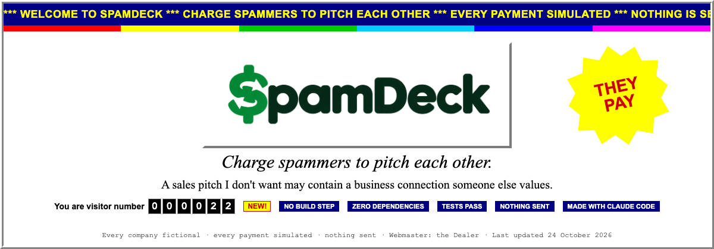


<p align="center"></p>

# Charge spammers to pitch each other.

You receive sales pitches you never asked for, and a company pitching you is often exactly the customer another company pitching you is looking for. SpamDeck's AI, the Dealer, reads each pitch, works out what the company sells and whom it wants to reach, and finds the companies that want each other. They opt in, pay to pitch each other, and the inboxes that supplied them take a cut: nothing is sold without consent, and no contact details change hands until both sides agree and the pitcher has paid.

## Try it

**Live:** https://liquidsoftwaredevelopment.github.io/SpamDeck/

Or clone and open `index.html`, or `python3 -m http.server 8791` and open http://127.0.0.1:8791 (`npm start` does the same).

No build step, no dependencies, no account. Every company is fictional (`.example` domains). Every payment is simulated. Nothing is sent.

## The two-minute walkthrough

Press **Play the story**: fourteen steps narrated by the Dealer (`js/app/tour.js`). **Next**, **Back** or the arrow keys move; **Exit** keeps everything as it is. `?story=N` jumps a fresh demo to a step, counting from 0. Amounts are a fresh demo's, all simulated.

1. **Your inbox.** 22 unsolicited pitches, pooled from yours, Priya's and Hirewire's inboxes.
2. **The Dealer reads.** Cards land on the Deck one by one.
3. **Dealt, binned, merged.** 18 companies dealt. A newsletter and a scam binned. Hirewire's two emails and Deskwell's two become one card each.
4. **The matches.** 21 pairs want each other. The desk maker, the coffee roaster and the outbound agency are each other's best matches.
5. **The letter.** All 18 get the same invitation: what was read, what was not shared, and deletion in 30 days if they do nothing.
6. **Who said yes.** You are Ledgerly now: the join form opens and you name your price. Next signs up ten more (Meridian asks for credits, Brightpath opens its booth to anyone at $500); Podly declines, and that is the end of Podly.
7. **Pay to pitch.** Hirewire scores Ledgerly 80 out of 100 and offers Ledgerly's price, $75, for a read. Ledgerly accepts.
8. **The fake checkout.** SpamPay opens and you press the fake Pay button. The $75 is held, and the introduction goes out: the first time either side sees the other's address.
9. **Get paid to listen.** Ledgerly answers "interested": $37.50 to Ledgerly, $22.50 to you for supplying both sides, $15.00 to SpamDeck.
10. **Across the pool.** Chatterbox (your inbox) pays $100 to pitch Boomerang Returns (Priya's). Priya earns $20, you $10.
11. **Listen to earn.** Meridian reads Outreachly's pitch for $46.88 in credits instead of $37.50 in cash, then spends $45 of them pitching Deskwell.
12. **The swap.** Deskwell and Nordic Bean, desks and coffee, pitch each other, each paying the other's meeting price ($50 and $80).
13. **The open booth.** Chatterbox pays $500 to pitch Brightpath with no match at all (10 out of 100).
14. **Your inbox, now.** 14 pitches came in. $235.00 went out to you, $35.00 to Priya. Now paste one of your own.

## What is real, what is simulated

As in the app's **What is real** tab. Row by row: [docs/WHAT_IS_REAL.md](docs/WHAT_IS_REAL.md).

| Part | Status |
|---|---|
| Reading pitches (the AI) | Real when Live AI is on: your key, your browser, straight to the Anthropic API. Otherwise: hand-labeled demo cards, and an offline simple reader for pasted pitches. Each card names its reader. The simple reader matches the hand labels on 22 of 22 names and categories (`tests/extract.test.js`), on the emails its rules were written for. |
| Matching | Real. Deterministic code, every point explained (`js/engine/match.js`). The weights are a first guess, tuned by hand on this deck. |
| Consent and the invitations | Real logic, fictional people. Nothing is sent; you play the companies from the menu at the top. |
| Payments | Simulated. SpamPay is a fake checkout. No payment provider, no card, no money. |
| The ledger and the splits | Real arithmetic on simulated payments, conserved to the cent (`tests/market.test.js`). |
| Credits | Real logic, simulated value. |
| The pool (three inboxes) | Fictional. Every company, person and domain is invented. |
| Traction | None. No users, no revenue, no pilots. This is a competition entry. |

## How it works

1. **The Dealer reads** each pitch into a card, in a fixed vocabulary so that cards compare: what the company sells, its size and teams, whom it wants. Scams and newsletters are binned; repeat senders merge.
2. **The deck** holds one card per company, contact details hidden.
3. **Matches.** Every ordered pair scores 0 to 100 on industry, size, role and situation, with a sentence per point. 55 is a match, 70 is hot; rivals are never introduced.
4. **The letter** invites each company with full disclosure. Doing nothing deletes its card in 30 days.
5. **Pay to pitch.** A company that joins prices its attention. A matched company pays for a read, a meeting at twice the price, or a swap. The money is held until the listener answers.
6. **The split** divides each payment four ways (below).
7. **Credits.** A listener may take 25% more in credits, spendable only on pitching.
8. **Open pitches.** One pitch, a price per read, a budget. Any matched company can read it, answer and keep the listener's share.
9. **The pool.** Inboxes pool their spam, and companies that join bring theirs: Hirewire was pitched, joined, and contributed its inbox, where Vettd's pitch matches Hirewire.

Weights, thresholds, state machine and ledger: [docs/HOW_IT_WORKS.md](docs/HOW_IT_WORKS.md).

## The money

All payments are simulated. Defaults from `js/engine/market.js`, adjustable under **Ledger → House rules**; a first guess, not a measurement.

| Share of each paid pitch | Default |
|---|---|
| The listener | 50% |
| The inbox that supplied the listener | 20% |
| The inbox that supplied the pitcher | 10% |
| SpamDeck | 20% |

**The credits identity.** A listener who takes credits gets 50% × 1.25 = 62.5% of the payment in credits, and SpamDeck keeps the 50% in cash. When the credits are spent, SpamDeck pays the listener and both inboxes in cash and forgoes its 20%. The sweetener (0.25 × 0.5) and the forgone fee (0.2 × 1.25 × 0.5) are both 0.125 of the original payment, so the held cash covers the credits exactly and SpamDeck nets zero on that flow: (1 + 0.25) × (1 − 0.20) = 1. Checked against `distribute()` and `tests/market.test.js`. It holds at the defaults only: the bonus stays at 25% when the house rules change.

Incentives, prices and open questions: [docs/BUSINESS_MODEL.md](docs/BUSINESS_MODEL.md).

## Live AI (bring your own key)

The demo needs no key. To read live, click **Live AI: off**, paste an Anthropic API key, pick a model and **Save**, then press **Re-read with Claude (live)** on any dealt email (**Read with Claude (live)** on a new one). Models (`js/engine/extract.js`): Claude Opus 5.5 (default), Claude Sonnet 5.5 (cheaper), Claude Haiku 5.5 (cheapest).

The key stays in this tab's `sessionStorage`. Requests go from your browser straight to `api.anthropic.com`; there is no SpamDeck server, and that request is the only network call in the code (`js/app/claude.js`).

The **What is real** tab shows the system prompt and the JSON schema every card must fit. A refusal, a cut-off answer or invalid JSON becomes a plain-English error, never an invented card.

## How it would work for real

Not built, by design: the demo stops at the edge of the real world. The plan for each pipe, in plain words.

- **Money.** A marketplace payment provider (Stripe Connect is the standard one) takes the pitcher's card payment, holds it, and on the listener's confirmation pays out the four shares to four accounts: the listener, the two inboxes, and SpamDeck. Credits stay an internal ledger and never cash out. Needs a small server for the provider's keys and its confirmation callbacks, and onboarding for anyone who gets paid.
- **Email in.** Read-only access to the inbox owner's junk folder (and any folder they choose) through the provider's own sign-in (Gmail or Outlook), so SpamDeck never holds a mailbox password. The Dealer reads, bins the real junk, and deals the pitches.
- **Email out.** SpamDeck writes from its own address, never from the inbox owner's. Invitations and introductions go out under SpamDeck's name, and replies come back to SpamDeck. The owner's mail provider is never taught that the spam was welcome, and the owner's inbox is never touched.
- **Consent record.** Every invitation, join, decline, offer and payment is already a dated ledger entry in the engine; for real it is stored server-side and exportable, which is what the legal review will ask for first.

## Run the tests

```
node --test
```

Node 18 or later, zero dependencies. 109 tests in 13 files, 109 passing (measured on Node 24.16.0, 2026-10-24): splits and cash to the cent, consent in order, refunds, odd input, 300 seeded random runs of the market, the simple reader's accuracy floor, and the whole story replayed (`tests/tour_replay.test.js`). GitHub Pages deploys only after they pass (`.github/workflows/pages.yml`).

## Honest notes

- **Will spammers pay?** Reasoned, not measured: they already pay for leads and meetings (one card here sells exactly that), and a consented, matched introduction costs less than an agency.
- **Will anyone listen for money?** The listener sets the price; if nobody accepts at $75, the market finds the price. Untested.
- **Legal.** No contact details are sold: the card is a description, the contact appears only after both sides agree and the pitcher pays, and the invitation replies to an email the company sent first. A real launch still needs counsel on CAN-SPAM, GDPR and consent records.
- **Cold start.** A thin pool has few matches. The viral loop and listen-to-earn answer that on paper only.
- **The matcher is explainable, not learned.** It misses matches a human would see. Fed by the simple reader instead of the hand labels, it finds 2 mutual matches instead of 21 ([reproduce it](docs/WHAT_IS_REAL.md#measured-numbers-and-how-to-reproduce-them)).
- **The joke must never read as mean.** The invitation is written to be read by the person it names. Keep it that way.

## Credits

Concept: Michael Allen. Built in Claude Code, with Claude Fable 5.1 leading and Claude Opus 5.5 helpers. MIT license ([LICENSE](LICENSE)).

[How it works](docs/HOW_IT_WORKS.md) · [Business model](docs/BUSINESS_MODEL.md) · [What is real](docs/WHAT_IS_REAL.md) · [Demo script](docs/DEMO_SCRIPT.md) · [Build log](docs/BUILD_LOG.md)
